# BUT3 R&T : SAE 5.01

## Développer et déployer un microservice dans un environnement virtualisé

<span style="font-size: 1.6em; color: gray;"><em>Compte rendu — VISA_2</em></span>

## Contexte

Le VISA_2 reprend le projet préparé lors du VISA_1. Le site Web « Produit Gourmand » fonctionne toujours avec PHP, mais la base de données SQLite est remplacée par un service MariaDB indépendant.

L'objectif est donc de séparer plus clairement le service Web et le service de base de données. Les deux services sont conteneurisés avec Docker et communiquent à travers un réseau Docker privé.

Cette version permet également de rendre la connexion à la base de données plus uniforme dans le code PHP, plutôt que de configurer une connexion différente dans chaque page.

## Partie II : Remplacement de SQLite par MariaDB

### II.1. Architecture générale

Dans le VISA_1, SQLite était utilisé directement par le service Web à partir de fichiers montés dans le conteneur. Pour le VISA_2, nous remplaçons ce fonctionnement par MariaDB, qui fonctionne dans son propre conteneur.

Le projet contient donc deux services principaux :

- **web** : le site PHP exécuté par Apache ;
- **mariadb** : le serveur de base de données MariaDB.

Le service Web communique avec MariaDB par le réseau Docker `app_network`. Il utilise le nom de service `mariadb` comme nom d'hôte et le port `3306` pour la connexion SQL. Le port de MariaDB n'est pas publié directement sur la VM : il est accessible depuis les conteneurs connectés au réseau Docker.

Le site Web reste accessible via le port `8080` de la VM, redirigé vers le port `80` du conteneur Web.

>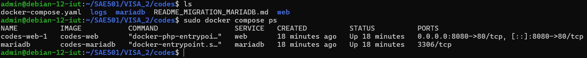

### II.2. Configuration du service MariaDB

Le service MariaDB utilise l'image `mariadb:10.11`, construite à partir du fichier `mariadb/Dockerfile`.

Le fichier `docker-compose.yaml` configure les variables suivantes :

- `MARIADB_ROOT_PASSWORD` : mot de passe du compte administrateur MariaDB ;
- `MARIADB_DATABASE` : nom de la base créée lors de l'initialisation ;
- `MARIADB_USER` et `MARIADB_PASSWORD` : compte utilisé par l'application Web.

La base de données utilisée par le projet est `BDD_VISA2`. Les données sont conservées dans le dossier `mariadb/data`, monté dans `/var/lib/mysql` dans le conteneur. Ainsi, les données ne sont pas stockées uniquement dans la couche éphémère du conteneur.

Le script `mariadb/23-ProduitsGourmands.sql` est monté dans `/docker-entrypoint-initdb.d/`. L'image MariaDB exécute ce type de script lors de la première initialisation d'un répertoire de données vide. Si la base a déjà été initialisée, modifier le script ne suffit pas à appliquer automatiquement les changements.

>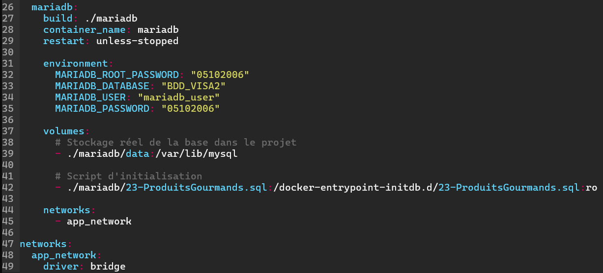

### II.3. Création du schéma de base de données

Le script SQL rassemble dans une seule base les données auparavant réparties entre les fichiers SQLite du projet.

Il crée les tables suivantes :

- `Producteur`, qui contient les informations sur les producteurs ;
- `Produit`, qui contient les produits, leur prix, leur caractère biologique et leur chemin d'image ;
- `Utilisateur`, qui contient les comptes du site et leur statut (`user` ou `admin`).

La table `Produit` possède une clé étrangère vers `Producteur`. La contrainte permet de relier un produit à son producteur et définit le comportement en cas de suppression ou de modification de l'identifiant du producteur.

Le script ajoute également deux comptes de test : un compte administrateur et un compte utilisateur. Ces comptes permettent de vérifier les différences de navigation selon le statut.

>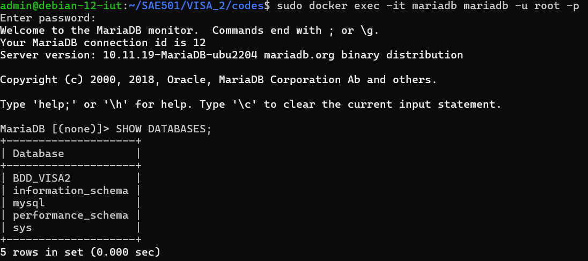
>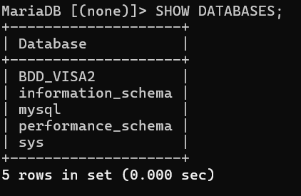
>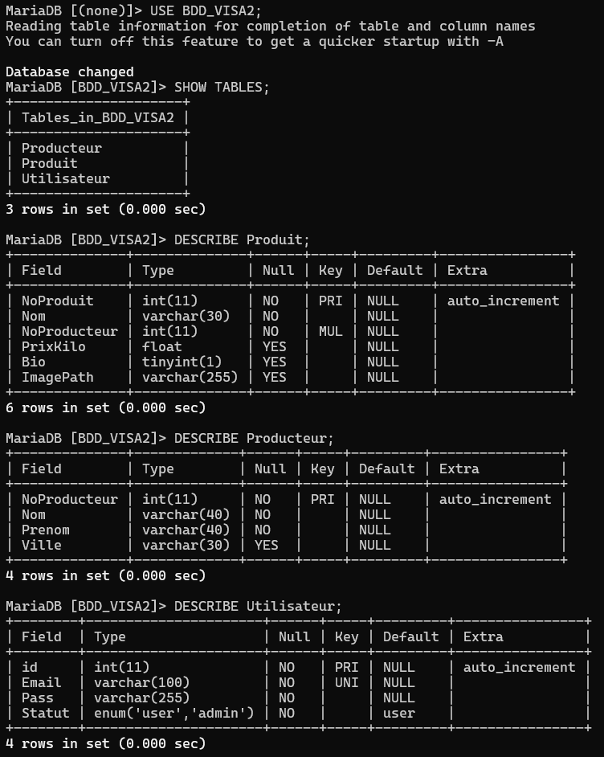

### II.4. Connexion à MariaDB depuis PHP

Pour éviter de répéter les paramètres de connexion dans toutes les pages, un fichier commun a été créé : `web/code/src/includes/database.php`.

Ce fichier définit la fonction `getDatabase()`. Elle utilise PDO pour établir la connexion à MariaDB. La connexion est conservée dans une variable statique : si plusieurs parties d'une même requête PHP appellent la fonction, elles réutilisent le même objet PDO.

Les paramètres de connexion sont fournis par les variables d'environnement définies dans `docker-compose.yaml` :

- `DB_HOST` ;
- `DB_PORT` ;
- `DB_NAME` ;
- `DB_USER` ;
- `DB_PASSWORD`.

Le code PHP n'a donc plus besoin de contenir les paramètres de connexion dans chaque page. Le nom d'hôte `mariadb` correspond au nom du service sur le réseau Docker. Le nom de la base est `BDD_VISA2`.

PDO est configuré pour signaler les erreurs sous forme d'exceptions, utiliser les résultats associatifs par défaut et désactiver les requêtes préparées émulées. Les pages qui accèdent à la base peuvent alors appeler la fonction commune au lieu de créer directement un objet SQLite.

>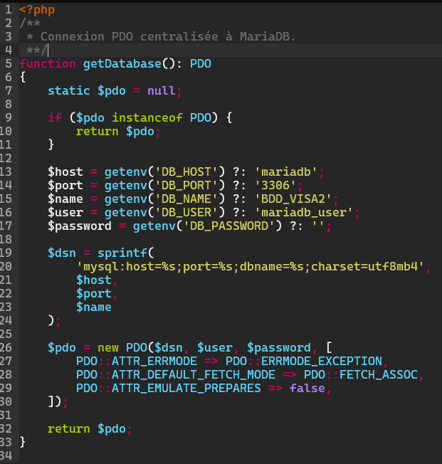

### II.5. Adaptation du code PHP

Les pages qui utilisent la base ont été adaptées pour remplacer l'ancienne API SQLite par PDO et MariaDB.

Les requêtes SQL utilisent désormais les tables de `BDD_VISA2`. Les résultats sont récupérés avec les méthodes PDO, par exemple `fetch()` ou `fetchAll()`, au lieu des méthodes propres à SQLite.

La table `Utilisateur` est utilisée pour l'authentification. Les pages de gestion des produits utilisent les tables `Produit` et `Producteur`, avec une jointure lorsque les informations du producteur doivent être affichées avec celles du produit.

Cette adaptation conserve le principe de fonctionnement du site : l'utilisateur se connecte, puis accède aux pages autorisées selon son statut. Les opérations de consultation, d'ajout, de modification et de suppression doivent être vérifiées depuis le site après le déploiement.

<!-- CAPTURE 5 — À INSÉRER : page d'accueil ou liste de produits affichée dans le navigateur après connexion.
Preuve côté serveur :
sudo docker compose logs --tail=50 web mariadb
Puis tester dans le navigateur :
https://sae501.yomikr.fr
La capture doit montrer le résultat dans le navigateur ; les logs seuls ne prouvent pas que l'affichage est correct. -->

>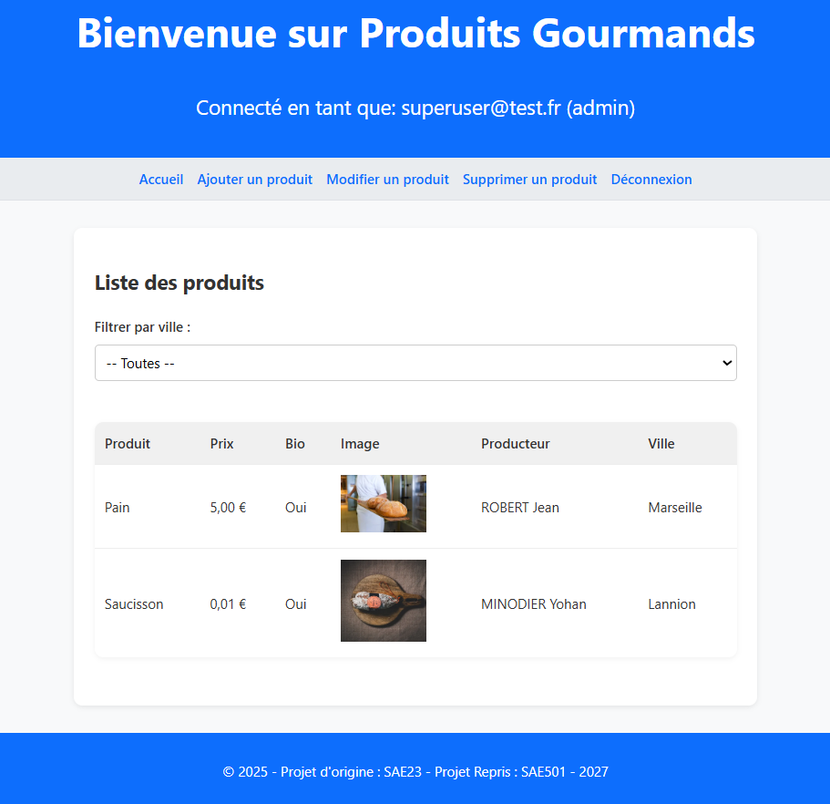
>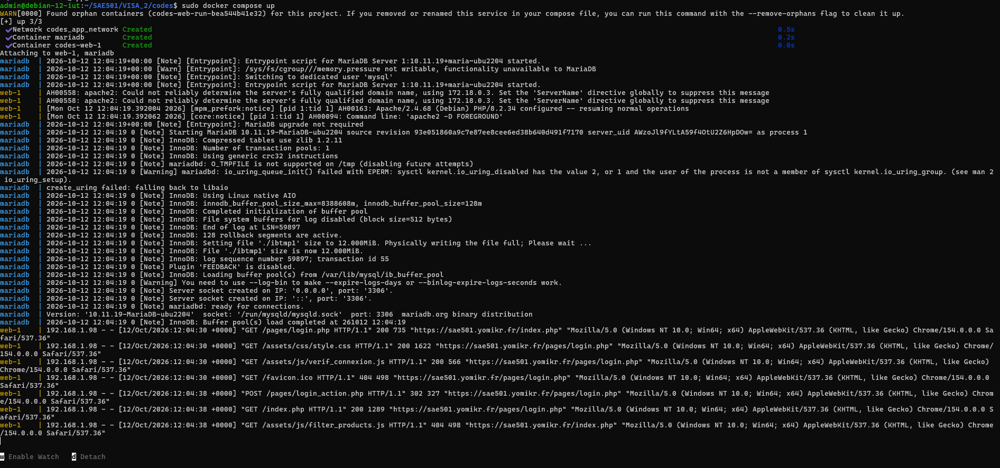

### II.6. Séparation des fichiers CSS et JavaScript

Pour améliorer l'organisation du code, les styles et les scripts intégrés directement dans certaines pages PHP ont été déplacés dans des fichiers dédiés sous `web/code/public/assets/`.

Les feuilles de style sont placées dans `assets/css/` et les scripts JavaScript dans `assets/js/`. Les pages PHP conservent ainsi principalement le traitement serveur et la structure HTML, tandis que les styles et les interactions côté navigateur sont gérés séparément.

Cette organisation facilite la maintenance du projet et évite de mélanger autant que possible le PHP, le CSS et le JavaScript dans un même fichier.

>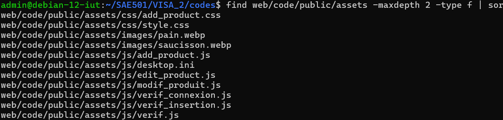

### II.7. Configuration du service Web

Le service Web utilise l'image de base `php:8.2-apache`. Le fichier `web/Dockerfile` installe l'extension PHP `pdo_mysql`, nécessaire pour utiliser PDO avec MariaDB.

Le fichier `docker-compose.yaml` monte le répertoire public du projet dans `/var/www/html` et les fichiers internes dans `/var/www/src`. Les paramètres de connexion sont transmis au conteneur par les variables d'environnement. Le service Web dépend du service MariaDB et les deux services sont raccordés au réseau `app_network`.

Le déploiement ou la reconstruction des services s'effectue depuis le dossier du projet avec Docker Compose.

```bash
sudo docker compose up -d --build
```

On vérifie ensuite l'état des services :

```bash
sudo docker compose ps
```

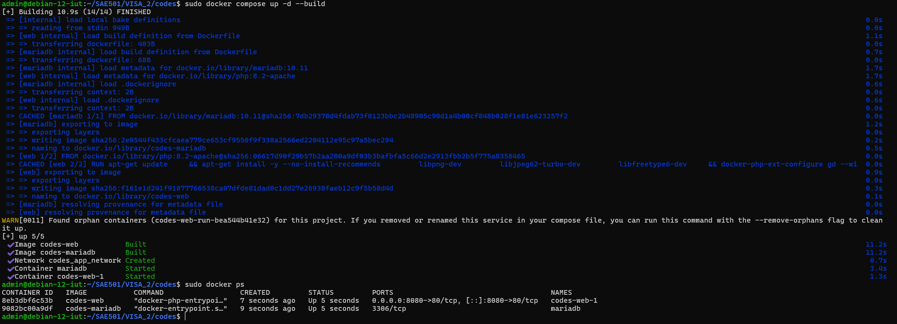

### II.8. Vérifications du fonctionnement

Plusieurs vérifications permettent de confirmer que les services sont en place.

#### Vérification de la connexion à MariaDB

La commande suivante permet d'ouvrir un client MariaDB dans le conteneur :

```bash
sudo docker exec -it mariadb mariadb -u root -p
```

Puis :

```sql
USE BDD_VISA2;
SHOW TABLES;
SELECT COUNT(*) FROM Produit;
SELECT COUNT(*) FROM Producteur;
SELECT COUNT(*) FROM Utilisateur;
```

Ces commandes vérifient que la base existe, que les tables sont présentes et qu'elles contiennent des données. Elles ne suffisent toutefois pas à prouver que le compte applicatif dispose des droits nécessaires.

#### Vérification des droits du compte applicatif

Depuis le client MariaDB :

```sql
SHOW GRANTS FOR 'mariadb_user'@'%';
```

Si le compte est défini avec un autre hôte, il faut afficher les droits correspondant à cet hôte. Le compte applicatif doit disposer des droits nécessaires sur `BDD_VISA2`.

#### Vérification de la configuration PHP

Pour vérifier que PDO et son pilote MySQL sont installés :

```bash
sudo docker exec -it codes-web-1 php -m | grep -E 'PDO|pdo_mysql'
```

Le résultat doit notamment contenir `PDO` et `pdo_mysql`.

Le nom `codes-web-1` correspond au nom du conteneur observé sur la VM ; si Docker lui attribue un autre nom, utiliser celui retourné par `sudo docker compose ps`.

#### Vérification des journaux

Les journaux permettent de repérer les erreurs de connexion ou de requête :

```bash
sudo docker compose logs --tail=100 web mariadb
```

Enfin, il faut tester le site depuis un navigateur : connexion avec un compte de test, affichage des produits, puis tests des fonctions de gestion avec le compte administrateur. Les opérations d'ajout, de modification et de suppression doivent être testées uniquement avec des données prévues pour les essais.

>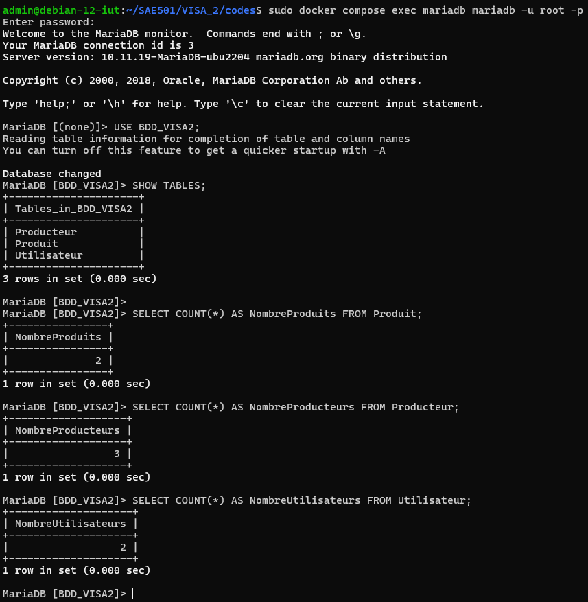
>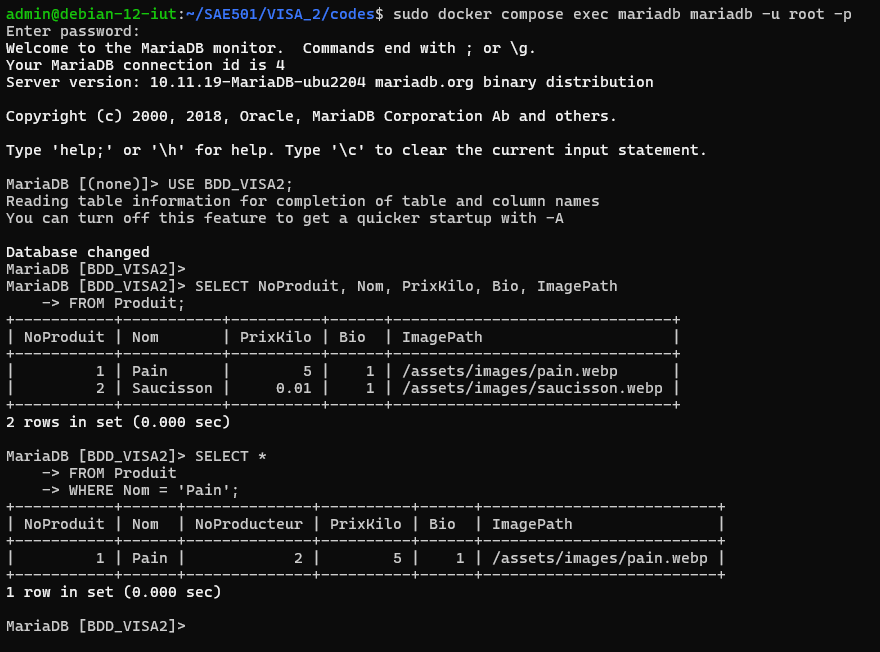

## II.9. Points de vigilance

Le dossier `mariadb/data` contient les données persistantes de MariaDB. Il ne faut pas le supprimer pour forcer l'exécution du script SQL, sauf si une réinitialisation complète est voulue et qu'une sauvegarde a été réalisée. Une modification du script d'initialisation ne modifie pas automatiquement une base existante.

Les identifiants définis directement dans `docker-compose.yaml` sont pratiques pour un environnement de test, mais ne doivent pas être conservés ainsi pour un déploiement exposé. Il est préférable d'utiliser un fichier `.env` non versionné ou un mécanisme de secrets.

Les permissions des fichiers doivent également être vérifiées. Le serveur Web doit pouvoir lire les fichiers du site et écrire uniquement dans les répertoires où cela est nécessaire, par exemple le dossier des images si l'application autorise l'envoi d'images. Il n'est pas nécessaire de rendre l'ensemble du site accessible en écriture.

Enfin, une page qui s'affiche ne suffit pas à prouver que toutes les opérations fonctionnent. Il faut tester au minimum la connexion, la lecture des produits et les opérations de gestion prévues par le projet.

## II.10. Conclusion du VISA_2

Dans cette partie, la base de données SQLite a été remplacée par un service MariaDB distinct. Le projet comporte maintenant un conteneur Web et un conteneur de base de données, reliés par un réseau Docker.

La connexion PDO a été centralisée dans un fichier commun afin d'éviter de dupliquer la configuration dans les pages PHP. Le code qui accède aux données a été adapté au schéma MariaDB et les fichiers CSS et JavaScript ont été séparés de certaines pages PHP pour rendre l'organisation plus claire.

Les vérifications finales portent sur le démarrage des deux conteneurs, la présence des tables, les droits du compte applicatif et les fonctionnalités du site depuis le navigateur.
